<p align="center">
  <a href="https://www.alexmatias.dev.br">
    
  </a>
</p>

<p align="center">
  <a href="https://www.alexmatias.dev.br"></a>
  <a href="https://www.linkedin.com/in/alex-matias-silva"></a>
  <a href="mailto:alexmatias.am162@gmail.com"></a>
</p>


### ⎇ sobre
<sub><code>$ cat sobre.md</code></sub>

Sou desenvolvedor de software .NET com **4 anos de experiência** no desenvolvimento, modernização e integração de sistemas corporativos, com foco em **regras de negócio, dados e performance**.

Hoje trabalho na **CartSys**, no ERP desktop usado por cartórios de Protesto, RTD/PJ, Registro de Imóveis e Notas: uma solução com mais de 75 projetos em C#, com módulos Financeiro e NFS-e. Antes passei quase três anos na **indústria (Condumig)**, sustentando sistemas legados críticos e automatizando processos de fábrica em C#.

Por conta própria, desenvolvo **sistemas de gestão para pequenos comércios** (oficinas, lojas de suprimentos de impressão e lojas de roupas) e estou levando meu foco cada vez mais para **ASP.NET Core Web API** e arquitetura em camadas.

```diff
@@ resultados @@
+ −75%    tempo de resposta de um sistema legado: 40s → 10s         Condumig · VB6 + MySQL
+ −25%    cálculo de custas de 1.608 títulos: 7min20s → 5min30s     CartSys · Entity Framework
+ −10%+   desperdício de materiais, com BI por máquina              Condumig · MySQL + QlikView
```


### ⎇ carreira
<sub><code>$ git log --graph --oneline carreira</code></sub>

<p align="center">
  
</p>

**No dia a dia:**

- 🏦 **Integrações via API REST**: cobrança bancária com a Unicred (emissão, baixa, pagamento e impressão de boletos em lote, autenticação por token e tratamento de falhas HTTP) e NFS-e com provedores municipais e nacional.
- ⚡ **Performance e dados**: rotinas em lote para banco em nuvem via VPN (carga em blocos, cache, inserts multi-row), otimização do Entity Framework, queries e índices.
- 🔐 **Assinatura digital**: livro eletrônico em PDF/A com hash SHA-256 e assinatura CMS com certificado digital.
- 🏭 **Automação industrial**: controle de impressão, auditoria de pesagem com alertas no Telegram e integrações com o Progress (Datasul).
- 🔄 **Modernização de legado**: VB6 e VB.NET para C#, WinForms/WPF, DevExpress WXI em centenas de formulários.


### ⎇ stack
<sub><code>$ dotnet list package --include-transitive</code></sub>

<p align="center">
  
  
  
  
  
  
  
  <br>
  
  
  
  
  
  <br>
  
  
  
  
</p>


### ⎇ projetos
<sub><code>$ ls ~/projetos</code></sub>

| Projeto | O que é | Stack |
|---|---|---|
| 🟢 **[GestaoComercial](https://www.alexmatias.dev.br/projetos/gestao-comercial)** | Sistema desktop para lojas que vendem produtos e prestam serviço nos equipamentos dos clientes (toners, impressoras e papelaria) | `C#` `WinForms` `EF Core` `SQLite/PostgreSQL` |
| 🟢 **[GestaoModa](https://www.alexmatias.dev.br/projetos/gestao-moda)** | Vendas e estoque para lojas de roupas: PDV pelo teclado, grade de tamanhos e cores, crediário, trocas, caixa e 22 relatórios | `C#` `.NET 8` |
| 🟢 **[pdf-para-epub](https://github.com/alex-m-silva/pdf-para-epub)** | Conversor online de PDF para EPUB (Kindle, Kobo): front estático e API em Python com Calibre num container | `Python` `Docker` |
| 🟡 **[LionFinance](https://www.alexmatias.dev.br/projetos/lion-finance)** | API de finanças pessoais em camadas: Domain, Application, Infrastructure e API *(em desenvolvimento)* | `ASP.NET Core` `EF Core` |
| 🟢 **[CriadorInstalador](https://www.alexmatias.dev.br/projetos/criador-instalador)** | Programa que gera o instalador .msi de um sistema Windows Forms | `C#` `WiX` |

<sub>Alguns repositórios são privados; detalhes e telas estão no <a href="https://www.alexmatias.dev.br">portfólio</a>.</sub>


### ⎇ certificados
<sub><code>$ ls ~/certificados | grep balta.io</code></sub>

`ASP.NET 6` `ASP.NET Core Identity` `APIs com JWT` `Entity Framework` `Multi-tenant com EF Core` `Dapper + SQL Server` `Microsserviços` `Event-Driven Architecture` `Injeção de Dependência` `Domínios Ricos` `Testes de unidade` `Blazor Server` `Blazor WebAssembly` `PWA com Blazor` `Azure, Git e DevOps`


### ⎇ stats
<sub><code>$ git shortlog -sn --all</code></sub>

<p align="center">
  
  
</p>


<p align="center">
  <code>$ git commit -m "transformando regras de negócio complexas em software confiável"</code>
</p>
